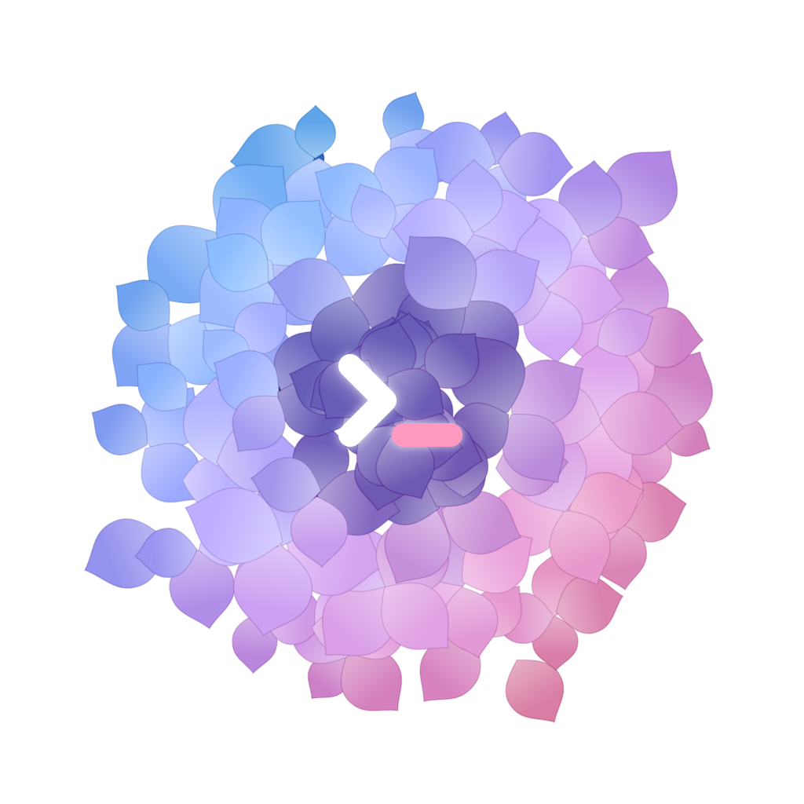

  

# Natsu brand

[中文](#中文) · [English](#english)

---

## 中文

### 名字

**Natsu** 是日语的「夏」（なつ），取自绣球名品 **无尽夏**（Endless Summer，品种名 'Bailmer'，学名 *Hydrangea macrophylla*，大叶绣球）。大叶绣球原产日本，这也是选用日语名字的原因。

| 无尽夏的特点 | 在 Natsu 里对应 |
|---|---|
| 老枝和当年新枝都能开花 | 已有分支和新开的 worktree 一起推进 |
| 一个花头上开着许多小花 | 一个仓库里，多个 agent 并行工作 |
| 花色随土壤酸碱度变化：酸性偏蓝、碱性偏粉、中性偏紫或混色 | 每个 worktree 在各自的环境里，长出自己的颜色 |
| 同一个夏天里反复开花 | 持续迭代 |

**事实说明**：无尽夏是**第一个**被商业化推广的、能在老枝和新枝上都开花的大叶绣球，而不是"唯一"一个。它约在 1983 年由 Vern Black 在 Bailey Nurseries 位于明尼苏达州圣保罗的农场发现，2004 年上市。此后又出现了许多同类的重复开花品种。对外文案请写"第一个"。

**商标**："Endless Summer®" 是 Bailey Nurseries 的注册商标。对外请写"灵感来自无尽夏绣球"，不要把 "Endless Summer" 用作产品名、副标题或 Slogan。（这是品牌层面的谨慎提醒，不构成法律意见。）

### 图标

主文件：[`assets/brand/natsu-mark.svg`](../assets/brand/natsu-mark.svg)

- **花头**：约 155 片松散叠放的绣球萼片，形状是宽卵形，末端带一个柔和的尖。许多萼片仍不规则地四片成组（绣球的一朵小花就是四片显眼的萼片），其余用来填缝；只保留少数几处花眼。
- **轮廓**：整体近似圆形，有几片花瓣飘出边缘。
- **质感**：花瓣不加阴影，每片有一圈细的深色描边，基部略浅。
- **颜色**：
  - 色相沿一条对角线变化：左上冰川蓝 → 长春花蓝 → 薰衣草紫 → 右下柔雾粉。
  - 明度沿半径变化：中心是较浅的靛紫，中间一圈花冠最亮，外缘略深，让轮廓在白底上也站得住。
- **提示符**：白色的 `>` 加柔雾粉的光标 `_`，带柔和的白色外发光，不加描边，放在中心的靛紫区域。绣球小花的中央有几枚很小、颜色很浓的真花瓣，这里借用了这个结构：终端就是花心。
- **背景**：
  - Windows / Linux 用透明底，圆形花头本身就是剪影。
  - macOS、iOS 和 Android 启动器使用白色底板。
  - 开发工具的图标大多深色、偏冷；白底和粉彩是刻意做出的区别。

### 色板

花瓣颜色是连续取样的，下表给的是代表值。

| 名称 | 花冠（亮） | 外缘（深） | OKLCH（花冠 / 外缘） |
|---|---|---|---|
| 冰川蓝 Glacier | `#83C5FE` | `#57A5E6` | .80 .105 246 / .70 .123 246 |
| 长春花蓝 Periwinkle | `#B2B4FF` | `#9293EF` | .80 .115 282 / .70 .133 282 |
| 薰衣草紫 Lavender | `#DDA6EE` | `#C182D4` | .80 .115 318 / .70 .133 318 |
| 柔雾粉 Mist | `#F3A1C2` | `#D97DA4` | .80 .105 354 / .70 .123 354 |
| 花心靛紫 Centre | `#6B5BB5` | — | .53 .137 289 |
| 提示符 Prompt | `#FFFFFF` | — | — |
| 光标 Cursor | `#FF99C0` | — | — |

### 设计演进

- **v1**：沿用上游的八元素加载环骨架，把方块换成小花。和上游标志太接近，被否决。
- **v2**：深色渐变底板上，由 ✤ 形小花组成一个圆形花头。
- **v3**：改为透明底，散瓣叠放，白色 `>_` 嵌在深色花心里。
- **v4（当前）**：去掉花瓣阴影，花心调浅，`>_` 的描边换成白色外发光。

### 使用

现有的变体（单色版、小尺寸版、带底板的应用图标等）列在 [`assets/brand/README.md`](../assets/brand/README.md)。

- 不要把四种花色改成一整片线性渐变。
- 不要给 `>_` 加方块底。
- 不要拉伸、旋转或斜切图标。
- 只能用单色的场合（托盘、模板图、印刷），使用单色版。

### 参考资料

- [Bailey Nurseries – Endless Summer](https://shop.baileynurseries.com/Product/Detail/2880)
- [Heritage Museums & Gardens – Hydrangea macrophylla 'Endless Summer'](https://heritagemuseumsandgardens.org/hmg/reasearch-hydrangea-macrophylla-endless-summer-original/)
- [hydrangea.com – The story of reblooming bigleaf hydrangeas](https://hydrangea.com/blogs/growing-tips/the-story-of-reblooming-bigleaf-hydrangeas)
- [Clemson HGIC – Repeat Blooming Hydrangeas](https://hgic.clemson.edu/repeat-blooming-hydrangeas/)
- [RHS – Hydrangea macrophylla Endless Summer ('Bailmer')](https://www.rhs.org.uk/plants/202607/hydrangea-macrophylla-endless-summer-bailmer-h/details)
- [Arnold Arboretum – Are you a mophead hydrangea lover?](https://arboretum.harvard.edu/stories/are-you-a-mophead-hydrangea-lover)

---

## English

### The name

**Natsu** is Japanese for "summer" (夏, なつ). It comes from the hydrangea cultivar **Endless Summer** (无尽夏; cultivar 'Bailmer', *Hydrangea macrophylla*, the bigleaf hydrangea). The bigleaf hydrangea is native to Japan, which is why the name is Japanese.

| Endless Summer | In Natsu |
|---|---|
| Flowers on both old wood and the current season's new wood | Existing branches and fresh worktrees move forward together |
| Many florets on one flower head | Many agents working in parallel on one repository |
| Colour follows soil pH: acid → blue, alkaline → pink, neutral → purple or mixed | Each worktree grows its own colour in its own environment |
| Reblooms again and again through one summer | Continuous iteration |

**Facts note**: Endless Summer was the **first** commercially introduced bigleaf hydrangea to flower on both old and new wood — not the only one. It was discovered around 1983 by Vern Black at a Bailey Nurseries farm in St. Paul, Minnesota, and introduced in 2004. Many other reblooming cultivars have followed. Say "first" in public copy.

**Trademark**: "Endless Summer®" is a registered trademark of Bailey Nurseries. Say "inspired by the Endless Summer hydrangea", and never use "Endless Summer" as a product name, subtitle, or slogan. (This is brand caution, not legal advice.)

### The icon

Master file: [`assets/brand/natsu-mark.svg`](../assets/brand/natsu-mark.svg)

- **Flower head**: a mophead of about 155 loose, stacked hydrangea sepals, broad and ovate with a soft point. Many still sit in irregular groups of four — a hydrangea floret is four showy sepals — and the rest fill the gaps. Only a few floret "eyes" remain.
- **Silhouette**: roughly round, with a few petals drifting past the edge.
- **Finish**: no petal shadows. Each petal has a thin darker outline and a paler base.
- **Colour**:
  - Hue follows one diagonal path: glacier blue at the top left → periwinkle → lavender → mist pink at the bottom right.
  - Lightness follows the radius: a lighter indigo-violet centre, a light crown, and a slightly deeper rim, so the edge holds on white.
- **Prompt**: a white `>` and a mist-pink `_` cursor with a soft white outer glow and no keyline, set in the indigo centre. It borrows the small, intensely coloured true petals at the heart of a hydrangea floret: the terminal is the flower's heart.
- **Background**:
  - Transparent on Windows and Linux, where the round flower is the silhouette.
  - A white plate on macOS, iOS, and Android launchers.
  - Developer-tool icons are mostly dark and cool; the white, pastel look is a deliberate difference.

### Palette

Petal colours are sampled continuously; these are representative values.

| Name | Crown (light) | Rim (deep) | OKLCH (crown / rim) |
|---|---|---|---|
| Glacier | `#83C5FE` | `#57A5E6` | .80 .105 246 / .70 .123 246 |
| Periwinkle | `#B2B4FF` | `#9293EF` | .80 .115 282 / .70 .133 282 |
| Lavender | `#DDA6EE` | `#C182D4` | .80 .115 318 / .70 .133 318 |
| Mist | `#F3A1C2` | `#D97DA4` | .80 .105 354 / .70 .123 354 |
| Centre indigo | `#6B5BB5` | — | .53 .137 289 |
| Prompt | `#FFFFFF` | — | — |
| Cursor | `#FF99C0` | — | — |

### Design history

- **v1**: kept the upstream eight-element loading ring and swapped its squares for florets. Rejected as too close to the upstream mark.
- **v2**: a round mophead of ✤ florets on a dark gradient plate.
- **v3**: loose, stacked petals on a transparent background, with a white `>_` in a deep centre.
- **v4 (current)**: petal shadows removed, the centre lightened, and the `>_` keyline replaced by a white glow.

### Usage

The available variants (mono, small sizes, plated app icons, and so on) are listed in [`assets/brand/README.md`](../assets/brand/README.md).

- Don't recolour the petals into a single linear gradient wash.
- Don't put the `>_` on a tile.
- Don't stretch, rotate, or skew the icon.
- Where only one colour is allowed (tray, template images, print), use the mono variant.

### Sources

- [Bailey Nurseries – Endless Summer](https://shop.baileynurseries.com/Product/Detail/2880)
- [Heritage Museums & Gardens – Hydrangea macrophylla 'Endless Summer'](https://heritagemuseumsandgardens.org/hmg/reasearch-hydrangea-macrophylla-endless-summer-original/)
- [hydrangea.com – The story of reblooming bigleaf hydrangeas](https://hydrangea.com/blogs/growing-tips/the-story-of-reblooming-bigleaf-hydrangeas)
- [Clemson HGIC – Repeat Blooming Hydrangeas](https://hgic.clemson.edu/repeat-blooming-hydrangeas/)
- [RHS – Hydrangea macrophylla Endless Summer ('Bailmer')](https://www.rhs.org.uk/plants/202607/hydrangea-macrophylla-endless-summer-bailmer-h/details)
- [Arnold Arboretum – Are you a mophead hydrangea lover?](https://arboretum.harvard.edu/stories/are-you-a-mophead-hydrangea-lover)
